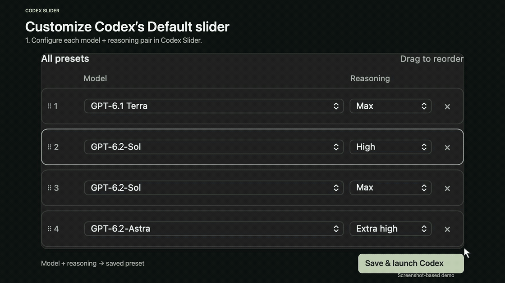
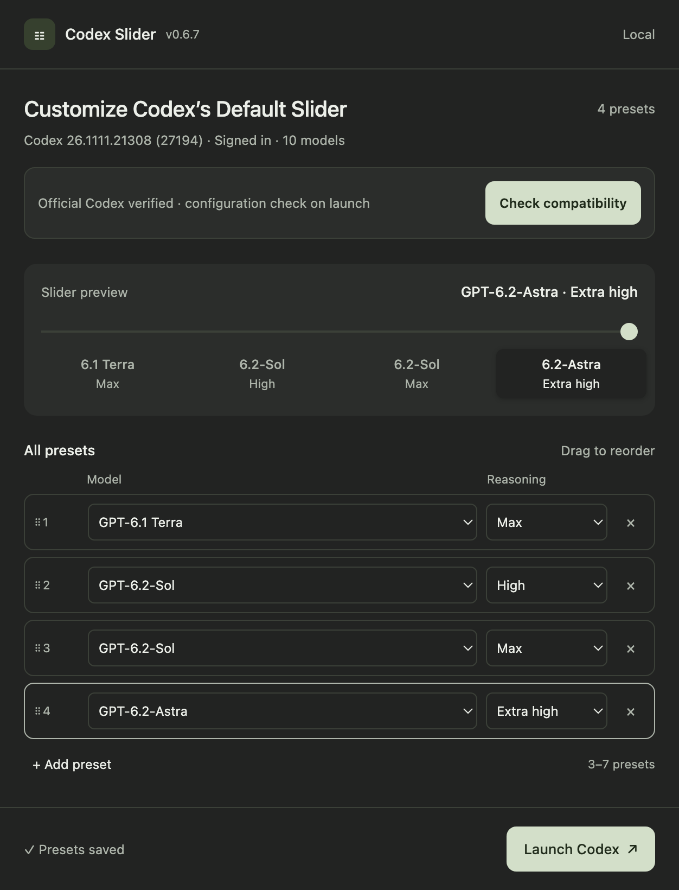

# Codex Slider

[](https://github.com/jiediking/codex-slider/actions/workflows/ci.yml)

Choose the **model and reasoning level for each stop** on Codex’s Default slider. Save 3–7 presets in the order you want.

## Install or update

You’ll need an Apple silicon Mac with macOS 15 or later, a signed-in Codex desktop app, and [arm64 Node.js](https://nodejs.org/en/download) 22.x (22.22.3 or later), 24.x, or 26.x.

Quit Slider if it’s open. Paste this line into Terminal and press Return:

```sh
/bin/bash -o pipefail -c '/usr/bin/curl -fsSL https://raw.githubusercontent.com/jiediking/codex-slider/main/install.sh | /bin/bash'
```

Then open **Codex Slider** from Applications. Updates keep your saved presets, and Codex can stay open during installation.

[Download 0.6.7](https://github.com/jiediking/codex-slider/releases/tag/v0.6.7) · [DMG](https://github.com/jiediking/codex-slider/releases/download/v0.6.7/Codex-Slider-0.6.7-macOS-arm64.dmg) · [Checksums](https://github.com/jiediking/codex-slider/releases/download/v0.6.7/SHA256SUMS.txt)

The app is locally signed and unnotarized. For a download you trust, see [Apple’s Open Anyway instructions](https://support.apple.com/en-us/102445).

## Use

1. **Set your presets.** Pick 3–7 distinct model and reasoning pairs and drag them into order.
2. **Launch through Slider.** Click **Save & launch Codex** or **Launch Codex** and follow the prompts. If Codex is open, use the reopen button, quit Codex with ⌘Q when prompted, then continue in Slider.
3. **Use the slider in Codex.** If you’ve selected a specific model, switch to **Default** first. Click **Default model** in the composer and drag the slider. Each stop uses its saved pair. Once Slider verifies your presets, the entire Slider app closes and Codex keeps running.



*From left to right, the demo uses GPT-6.1 Terra (Max), GPT-6.2 Sol (High), GPT-6.2 Sol (Max), and GPT-6.2 Astra (Extra High).* [MP4 version](docs/media/demo.mp4)

<details>
<summary>View the preset editor</summary>



</details>

**Still waiting for verification?** Keep Slider open and check the Default slider in Codex. If Codex is still showing its previous stops, Slider keeps checking.

**Codex updated?** Launch Codex through Slider again. Slider checks whether it can still apply and verify your presets. Keep using the same Slider version when the check passes.

**New model available?** Reopen Slider to refresh the models available to your Codex account, then choose which presets to update.

**Back to the standard slider.** Quit Codex, then reopen it from its own app icon.

**Local debugging.** Custom mode opens a debugging connection that other local apps can access until Codex quits, even after Slider closes. Use custom mode on a trusted Mac.

<details>
<summary>Development and releases</summary>

From the repo root, use a supported Node.js version, Python 3 and Bash for checks. The macOS build also needs the Xcode command line tools.

```sh
npm run check
npm test
python3 scripts/build_macos.py --arch arm64
```

The local App and DMG go to `dist-app/`. CI checks the source and package. Verify live behavior on a Mac.

On `main`, use the [manual release workflow](https://github.com/jiediking/codex-slider/actions/workflows/release.yml) to **prepare** from a successful macOS build. Follow the candidate’s `TESTING.md`. After real Mac testing and approval, **publish** with the candidate run ID and tested DMG SHA256. The workflow verifies the downloads and updates the stable installer and README links.

</details>

An unofficial companion for Codex. Presets use the models available to your account. [MIT License](LICENSE).
