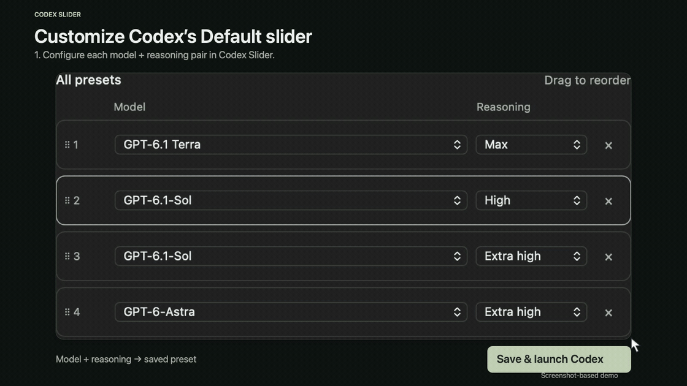
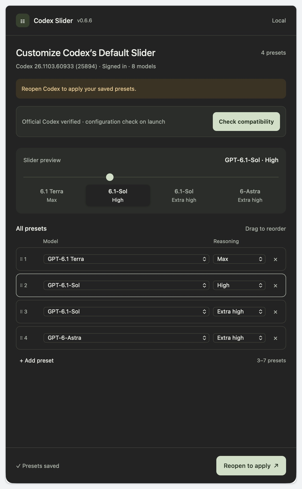
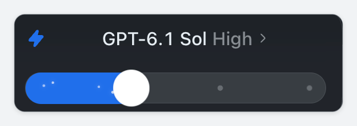

# Codex Slider

[](https://github.com/jiediking/codex-slider/actions/workflows/ci.yml)

A small macOS companion that lets you arrange **3–7 model and reasoning presets** and launch Codex with your custom Default slider.

## Requirements

- Apple Silicon Mac with macOS 15 or later.
- Codex desktop installed and signed in.
- Native arm64 Node.js 22.x (22.22.3 or later), 24.x, or 26.x.

## Install or update

Quit Codex Slider, then copy this line into Terminal:

```sh
/bin/bash -o pipefail -c '/usr/bin/curl -fsSL https://raw.githubusercontent.com/jiediking/codex-slider/main/install.sh | /bin/bash'
```

The installer checks the download, signature and Node dependency, installs `/Applications/Codex Slider.app`, and selects it in Finder. Open Slider to begin. Saved presets and existing consent are kept. macOS asks for administrator permission when needed.

[Download 0.6.6](https://github.com/jiediking/codex-slider/releases/tag/v0.6.6) · [DMG](https://github.com/jiediking/codex-slider/releases/download/v0.6.6/Codex-Slider-0.6.6-macOS-arm64.dmg) · [Checksums](https://github.com/jiediking/codex-slider/releases/download/v0.6.6/SHA256SUMS.txt)

The former downloads repository has been retired. Use the command above when upgrading from 0.6.5 or earlier. A manually selected compatibility source remains unchanged; if you selected the old downloads URL, replace it with `https://raw.githubusercontent.com/jiediking/codex-slider/main/compatibility-feed.json` using the App’s `--set-compatibility-url` command.

This preview is locally signed and not notarized. For a trusted copy blocked by macOS, follow [Apple’s Open Anyway instructions](https://support.apple.com/en-us/102445).

## Use

1. Choose 3–7 unique model/reasoning pairs and drag them into your preferred order.
2. Choose **Save & launch Codex**. Read and accept the local debugging explanation on first use. If Codex is already running, save your work and quit it normally when prompted.
3. Continue in Codex. Slider checks the applied presets automatically, including with the Default menu closed. After confirmation, the entire Slider app exits and Codex keeps running. Pending or failed checks keep Slider open.



*Screenshot-based animation using four saved presets.* [MP4 version](docs/media/demo.mp4)

<details>
<summary>View matching screenshots</summary>

The four slider positions follow the saved preset order. Both screenshots show preset **2: GPT-6.1 Sol · High**.

| Configure in Codex Slider | Use in Codex |
| --- | --- |
|  |  |

</details>

Launch through Slider whenever you want custom presets. Codex updates are checked with the existing adapter during launch. Builds outside the signed list do not require a new list entry while the configuration and observation interfaces remain usable. Loading or insufficient evidence stays unconfirmed.

**Custom mode opens a local Codex debugging interface that other local programs may use to inspect or change the renderer. It stays open until Codex fully quits, including after Slider exits. Use a trusted Mac with trusted local apps and accounts.**

Presets are saved in `~/Library/Application Support/Codex Slider/settings.json`. Opening Codex from its regular icon after fully quitting it uses the standard slider. A renderer reload may require another launch through Slider.

## Development checks

Run from the repository root with a supported Node.js version, Python 3 and Bash:

```sh
npm run check
npm test
```

No npm install is needed. CI runs offline checks on Node.js 22.22.3, 24 and 26. Runtime and build changes also trigger an arm64 macOS package build. Its artifacts are temporary verification packages, not official releases. CI does not launch Codex or verify a live slider.

## Manual releases

Maintainers use [Manual release](https://github.com/jiediking/codex-slider/actions/workflows/release.yml) on `main`:

1. Choose `prepare` and enter a successful **macOS build** run ID for current `main`. Download the candidate artifact (available for 30 days) and follow its `TESTING.md` on the current Mac or another Mac. Save your work first: the full launch test requires quitting Codex normally.
2. After real-Mac testing and explicit release approval, choose `publish`, enter that candidate run ID and the tested DMG SHA256, and check the publication confirmation. The workflow publishes the same files, verifies the public downloads, then updates the stable installer and README links.

Preparation creates no Release or tag and leaves the install command unchanged. Publication refuses an existing version or a changed source commit. A new version must be set in source before building; preparing the current version is safe for a rehearsal. If a run fails after creating a draft or publishing, inspect the Release and stable entry before repairing only the unfinished steps with the same files.

## Build from source

With a supported Node version and the Xcode command line tools installed, run from the repository root:

```sh
python3 scripts/build_macos.py --arch arm64
```

The locally signed App and DMG are written to `dist-app/`. Node is an external dependency. No npm packages are required. The installer source is a template whose package URL, version and checksum are filled during release.

Licensed under the [MIT License](LICENSE). This is an unofficial companion, not affiliated with OpenAI. Presets do not unlock model access. Slider sends no inference requests and installs no files inside Codex.
